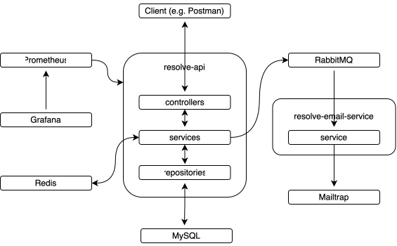
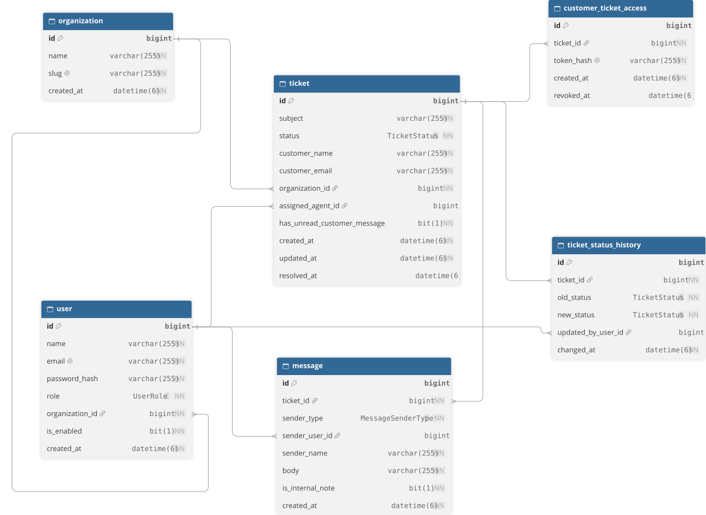

# Resolve

**Resolve** is a multi-tenant customer-support REST API built with Spring Boot. It provides organization-scoped ticket
management, role-based staff access, passwordless customer ticket access, asynchronous email notifications, and 
operational monitoring.

This is a backend-focused portfolio project. The API is usable through HTTP clients such as Postman; a frontend is not 
currently included.

## Motivation
I built this REST API as a personal project to get hands-on with technologies that were new to me, including Spring 
Boot, Spring MVC (Tomcat), Spring Data, Spring Security, RabbitMQ, Redis, Prometheus, and Grafana.

I also had the opportunity to use technologies and architectures I was already familiar with: Java, layered 
architecture, microservices, REST API design, JPA, transactions, MySQL, Docker, and JUnit/Mockito.

## Features

### Customers
- Submit support tickets to a specific organization using its URL slug.
- Receive an email confirmation containing a ticket-access link and token.
- View their ticket conversation and send follow-up messages without creating an account.
- Receive notifications when a support agent replies to their ticket.
- Continue a conversation until the ticket is archived. New messages on resolved tickets reopen them.
- View only customer-visible messages; internal staff notes remain private.

### Support Agents
- Browse their organization's tickets with pagination and sorting.
- View ticket conversations and status history, including internal notes.
- Send public replies or save internal notes.
- Update ticket status, assign tickets to agents in the same organization, and mark tickets as read.
- Retrieve individual ticket threads through a Redis cache, with MySQL as the source of truth.

### Administrators
- Access agent functionality.
- Create, view, and update staff accounts within their organization.
- Manage agent and administrator roles, subject to safeguards that prevent self-demotion and self-disabling.

## Technology Stack
| Area | Technologies and approaches |
| --- | --- |
| Language and Framework | Java 25, Spring Boot, Spring MVC, embedded Tomcat |
| Persistence | MySQL, Spring Data JPA, Hibernate, transactions |
| Caching | Redis, Spring Data Redis, cache-aside pattern |
| Messaging | RabbitMQ, Spring AMQP, durable queues, publisher confirms, retries, dead-letter queue |
| Notifications | Separate Spring Boot email service, JavaMailSender, Mailtrap SMTP |
| Observability | Spring Boot Actuator, Prometheus, Grafana |
| Infrastructure | Docker, Docker Compose |
| Security | Spring Security, session-based authentication, role- and organization-scoped authorization |
| Testing and Profiling | JUnit 5, Mockito, Spring MVC tests, Postman, MySQL `EXPLAIN ANALYZE` |

## Architecture
Resolve consists of two Spring Boot applications:
- `resolve-api`: The primary REST API, responsible for authentication, authorization, ticket management, persistence, 
caching, and publishing notification events.
- `resolve-email-service`: A notification consumer that receives messages from RabbitMQ and sends email through 
Mailtrap SMTP.

MySQL stores application data, Redis caches agent-facing ticket details, and RabbitMQ decouples email delivery from the 
request-response path. Prometheus collects application metrics exposed through Actuator, which can be visualized in 
Grafana.

### High-Level System Diagram


### Data Model


Relationships are implemented with JPA/Hibernate and persisted in MySQL. Repository access is scoped to the 
authenticated staff member's organization where applicable.

### Application Layers
The API follows a layered architecture:
- **Controllers** define endpoints, validate requests, and return response DTOs.
- **Services** implement ticket workflows, authorization checks, transaction boundaries, and DTO mapping.
- **Repositories** use Spring Data JPA to access relational data.
- **Infrastructure components** handle security, caching, messaging, email delivery, and metrics.

Key services include `PublicTicketService`, `AgentTicketService`, `AdminService`, `TokenService`, and 
`AgentTicketCacheService`. The email application has `EmailService`.

## API Overview
The following endpoints summarize the main functionality. Protected routes require an authenticated session and 
appropriate authorization.

### Public Ticket Endpoints
| Method | Endpoint | Description |
| --- | --- | --- |
| `POST` | `/api/public/organizations/{slug}/tickets` | Create a ticket for an organization |
| `GET` | `/api/public/tickets/{ticketId}` | View a ticket with a customer access token |
| `POST` | `/api/public/tickets/{ticketId}/messages` | Add a customer message with a customer access token |

Customer access tokens are supplied as query parameters on the ticket-access endpoints.

### Agent Ticket Endpoints
| Method | Endpoint | Description |
| --- | --- | --- |
| `GET` | `/api/agent/tickets?page=0&size=20&sort=updatedAt,desc` | List organization tickets |
| `GET` | `/api/agent/tickets/{ticketId}` | Retrieve a ticket thread |
| `POST` | `/api/agent/tickets/{ticketId}/messages` | Add a reply or internal note |
| `PATCH` | `/api/agent/tickets/{ticketId}/status` | Change ticket status |
| `PATCH` | `/api/agent/tickets/{ticketId}/assignedAgent` | Assign a staff member |
| `PATCH` | `/api/agent/tickets/{ticketId}/read` | Mark ticket as read |

### Administration Endpoints
| Method | Endpoint | Description |
| --- | --- | --- |
| `POST` | `/api/admin/users` | Create a staff account |
| `GET` | `/api/admin/users` | List organization staff |
| `PATCH` | `/api/admin/users/{userId}` | Update staff account details |

Authentication is handled under `/api/auth`, including login, current-user lookup, CSRF token generation (required for 
mutating requests using session authentication), and logout.

## Engineering Decisions and Trade-Offs

### Multi-Tenancy and Authorization
Resolve uses a shared database with organization-scoped data access. Agent and administrator operations are constrained 
to their own organizations, including ticket assignment and staff management.

Spring Security provides authentication and role-based authorization, while service-layer checks enforce resource-level 
organization boundaries. A dedicated `ResolveUserDetails` adapter implements Spring Security's `UserDetails` instead of 
coupling the JPA `User` entity directly to the security framework.

Staff passwords are securely hashed using BCrypt, while cryptographically random customer access tokens are hashed using 
SHA-256 before database storage.

### RabbitMQ Asynchronous Email Notifications
Email notifications are published to RabbitMQ and processed by `resolve-email-service`, keeping SMTP operations outside 
the primary API request path.

The messaging configuration includes a durable direct exchange and queue, publisher confirms and 
unroutable-message returns, consumer retries with exponential backoff, and dead-letter handling.

RabbitMQ was chosen over an in-process `@Async` task because a broker can retain queued work across application restarts
and support independent consumers.

Extracting email delivery into a separate application also provided experience with service boundaries and independent 
failure handling. For Resolve's purpose, a modular monolith could be simpler. The separate service is retained as a 
deliberate learning and architectural exercise rather than a claim that microservices are always preferable.

### Redis Agent-Facing Ticket Details Caching
Agent-facing ticket details use a cache-aside strategy:
1. Attempt to read the ticket response from Redis.
2. On a miss, retrieve the ticket and its messages from MySQL and populate the cache.
3. Invalidate cached data when ticket state changes.
4. Expire entries after a five-minute TTL.

Cache failures are handled so the API can fall back to MySQL instead of making Redis a hard dependency for ticket reads.

Cache invalidation is coordinated with database transaction commits to avoid evicting entries for changes that 
subsequently roll back. The implementation acknowledges limitations: concurrent requests can repopulate stale data, and 
an eviction can fail while Redis is unavailable. TTL bounds the lifetime of such stale entries but does not provide 
strict consistency.

Customer-facing ticket retrieval was deliberately left uncached because its expected access frequency is lower than 
agent-facing retrieval. This avoids unnecessary cache complexity and invalidation overhead for a workload where the 
performance benefit is less compelling.

### Transaction Management and Persistence
Services use `@Transactional` to define units of work. Hibernate dirty checking persists changes to managed entities 
without unnecessary explicit `save()` calls. Read-only transactions are used where appropriate to express query intent 
and allow Hibernate optimizations.

API responses use explicit DTOs rather than exposing JPA entities. This keeps the HTTP contract separate from 
persistence, avoids unintended entity serialization, and provides control over which fields are visible to each user 
role.

### Database Performance and Indexing
I profiled Resolve against a MySQL dataset containing 100,000 tickets, using concurrent requests (from Postman's load 
testing feature) to examine throughput and latency. Hibernate SQL logging and MySQL `EXPLAIN ANALYZE` helped identify query behavior and guide indexing 
decisions.

Composite indexes support common access patterns:
```sql
CREATE INDEX idx_message_ticket_created
    ON message (ticket_id, created_at);

CREATE INDEX idx_ticket_org_updated
    ON ticket (organization_id, updated_at DESC);

CREATE INDEX idx_user_org_created
    ON user (organization_id, created_at DESC);
```

These indexes target ticket-thread retrieval, organization-scoped ticket listings ordered by recent activity, and 
organization-scoped staff listings. Indexing choices were considered alongside write overhead and existing indexes 
rather than treating additional indexes as universally beneficial.

### Error Handling and API Design
A centralized `@RestControllerAdvice` maps application exceptions, validation failures, and malformed requests into 
consistent error responses with appropriate HTTP status codes. This reduces duplicated error-handling logic.

Resource-creation endpoints return DTOs with information clients need immediately, while update operations return 
`204 No Content` when no response body is necessary.

## Testing
Automated tests use JUnit 5, Mockito, and Spring's MVC test support. Coverage focuses on service behavior, controller 
request handling, and DTO validation. Resolve could benefit from more testing in terms of both breadth and depth.

Manual API testing with Postman complements automated tests, including authentication, authorization, cache behavior, 
messaging, and error scenarios.

## Running Locally

### Prerequisites
- Docker and Docker Compose.
- A Mailtrap SMTP account for sending test emails.
- A tool such as Postman or `curl` to call the API.

### 1. Clone the repository
```bash
git clone https://github.com/karimsammouri/resolve.git
cd resolve
```

### 2. Configure the environment
Create a `.env` file in the repository root with the environment variables referenced by `compose.yaml`. These include MySQL, RabbitMQ, and Mailtrap credentials.

### 3. Start the stack
```bash
docker compose --profile full up --build
```

The Docker Compose configuration is intended to run the application services and their supporting infrastructure. 
Consult `compose.yaml` for the exact services, ports, environment variables, and volumes used.

### 4. Exercise the API
Use Postman or another HTTP client to create an organization-scoped ticket, authenticate as a staff member, and test the
ticket-management endpoints. Customer ticket access requires the token issued during ticket creation and notification.

### 5. Inspect Monitoring
Use the Prometheus and Grafana services defined in Compose to inspect application metrics.

## Work in Progress
- Frontend interface.
- Agent user ability to search across organization-scoped tickets and messages.
- Expose selected operations through an MCP server for agentic AI workflows.
- Implement LLM chat assistance and organization-specific document knowledge retrieval using retrieval-augmented generation 
(RAG).